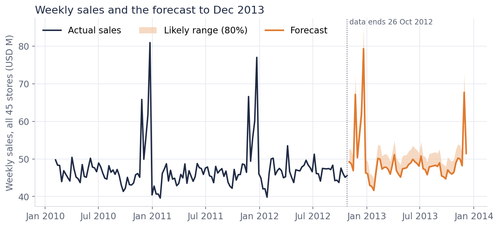
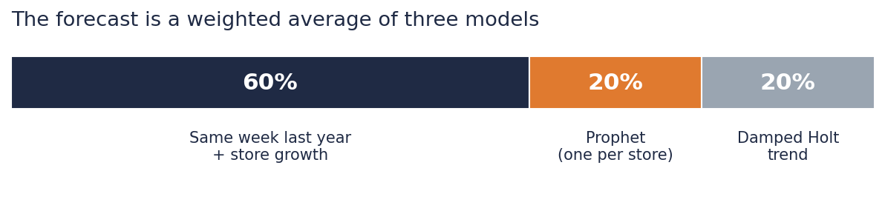
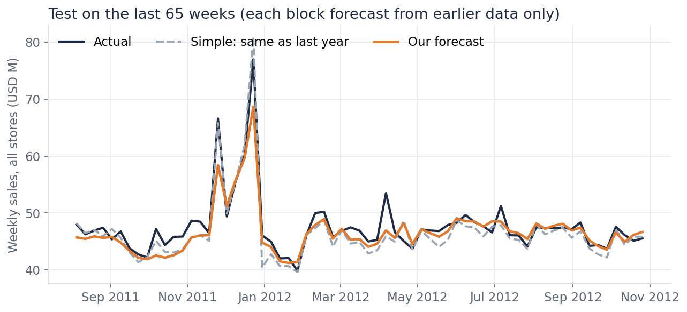
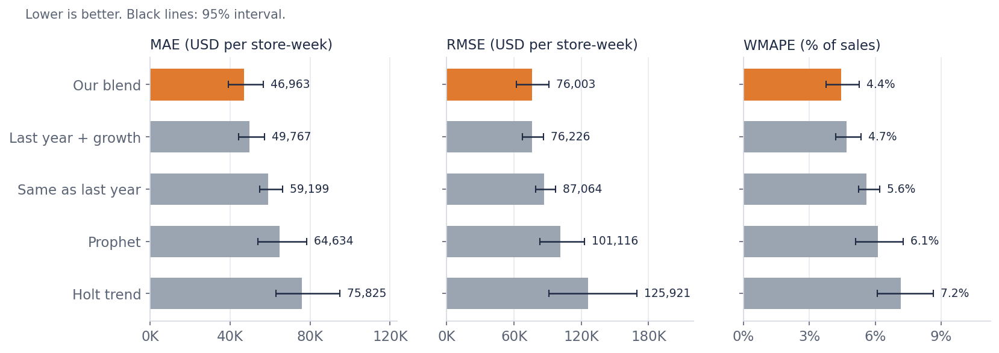
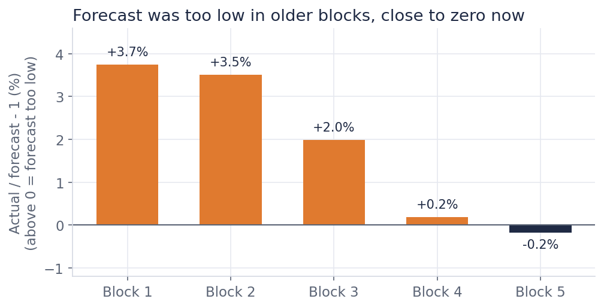

# Weekly Sales Forecast for 45 Stores

This project forecasts weekly sales for 45 stores, from **2 Nov 2012 to 6 Dec 2013**.
It also tests how good the forecast is.

### 👉 [Open the live dashboard](https://teyfj8uksts3w2vt4idfzx.streamlit.app/)



## The short answer

| | |
|---|---|
| **Forecast for 4 Jan - 6 Dec 2013** (49 weeks) | **USD 2,348M** |
| Compared with the same weeks of 2012 | about +1.5% |
| Likely range (80%) | USD 2,319M to USD 2,463M |
| Typical error for one store in one week | 4.4% |

This is **not** the full year. The last weeks of December, the biggest of the year, are not in this number.
The range is based on only five test blocks, so use it as a guide, not as a promise.

## How the forecast works

The forecast is a weighted average of three simple models.



1. **Same week last year + store growth (60%).** Copy the same week from last year, with holidays lined up, then adjust it for how fast each store is growing or falling.
2. **Prophet (20%).** One Prophet model for each store. It learns the yearly pattern and the holidays.
3. **Damped Holt trend (20%).** Follows the current level and direction of each store, then slows down so it does not run away.

The weights were not chosen by hand. The code tries many weight splits and keeps the one with the lowest error on earlier test blocks.
A fourth model (Ridge) was tested and got 0%.

Features are calendar only: time of year, Thanksgiving, Christmas, Super Bowl, Labor Day, Easter, and a trend.
No future data is used, so there is nothing to leak.

## How we tested it

We pretended not to know the last 65 weeks and forecast them in five blocks of 13 weeks.
Each block was forecast using only data from before it.
We compared the result with a simple baseline: **"same as last year"**.



## Results

Error of one store in one week (lower is better):

| Measure | Our forecast | Baseline (same as last year) |
|---|---|---|
| MAE (average miss, USD) | **46,963** | 59,199 |
| RMSE (big misses count more, USD) | **76,003** | 87,064 |
| WMAPE (miss as % of sales) | **4.4%** | 5.6% |

The gain in WMAPE is 1.2 points, with a 95% interval of 0.5 to 1.8 points. The interval does not include zero, so the gain is real.



Other checks:

| Check | Our forecast | Baseline |
|---|---|---|
| One store, whole test period | 2.2% | 4.1% |
| Whole company, one week | 2.9% | 3.1% |
| One full year ahead (58 weeks, one sample) | 5.3% | 5.9% |
| Bias (negative = forecast too low) | -1.8% | -2.2% |

The forecast was too low in older blocks and is close to zero in the last block:



## Limits (please read)

* **The data stops on 26 Oct 2012.** The 2012 holiday season has not been seen by the model.
* **Holiday weeks:** our forecast is not better than the baseline (6.5% vs 5.7%, only 7 weeks, so we cannot say more).
* **Whole company, one week:** the gain over the baseline is small (2.9% vs 3.1%). The gain is mostly at store level.
* **The error grows with distance.** Late 2013 is less reliable than early 2013.
* **Not modelled:** new or closed stores, promotions, economic shocks.
* We made some modelling choices while looking at 2011 and 2012, so real accuracy may be a little worse.
* The prediction bands held 86% of the time on later unseen weeks (target 80%).

More detail is in [`docs/business_memo.md`](docs/business_memo.md).

## Run it yourself

```bash
python -m venv .venv && source .venv/bin/activate
pip install -r requirements-dev.txt && pip install -e .

# put features.csv, sales.csv, stores.csv in data/raw/
# or: export SPEEDY_DATA_DIR=/path/to/folder

python -m speedy.train                        # backtest, fit, save model and dashboard files
python -m speedy.score --end-date 2013-12-06  # forecast CSV files
streamlit run app.py                          # dashboard on your computer
python docs/make_figures.py                   # redraw the pictures in this README
pytest -q                                     # tests
```

Environment variables: `SPEEDY_DATA_DIR`, `SPEEDY_MODEL_DIR`, `SPEEDY_OUTPUT_DIR`.

## Project layout

| Path | What it is |
|---|---|
| `src/speedy/features.py` | calendar features |
| `src/speedy/forecasters.py` | the base models: naive, naive with drift, Ridge, Holt, Prophet |
| `src/speedy/models.py`, `pipeline.py` | scikit-learn pipeline and the blend |
| `src/speedy/evaluate.py` | walk-forward test, weight search, full evaluation |
| `src/speedy/metrics.py` | MAE, RMSE, WMAPE, bias, bootstrap intervals, bands |
| `src/speedy/data.py`, `cleaning.py` | loading, checks, outlier handling |
| `src/speedy/train.py`, `score.py`, `inference.py` | commands to train and forecast |
| `app/streamlit_app.py`, `app.py` | the dashboard |
| `app_artifacts/` | ready files the dashboard reads (forecasts, evaluation, test results) |
| `notebooks/` | `01_eda` (look at the data), `02_modelling` (accuracy and forecast) |
| `docs/` | business memo, README pictures, `make_figures.py` |
| `tests/` | unit tests, leakage tests, train/score smoke test |

## Data decisions

* **Returns** (negative rows) stay in the sales. Reported revenue is net of returns, and the effect on the total is about 0.001%.
* **Outliers:** only non-holiday extremes are capped, and only with the training data. One store-week was changed.
* **`features.csv` is not used.** It has rows up to July 2013, which could not exist at the forecast date.
* **The saved model** (`joblib`) is a pickle: only load files you trained yourself.
* Raw data, models and outputs are not committed (`.gitignore`).

## Deploy the dashboard (Streamlit Community Cloud)

1. Run `python -m speedy.train` and commit the `app_artifacts/` folder.
2. In Streamlit Cloud: New app, pick this repo, main file `app.py`.
3. `app_artifacts/actuals_store_week.csv` and `backtest_store_week.csv` contain company sales numbers, and the dashboard needs `actuals_store_week.csv` to run. Only put the repo on public GitHub if this data may be public.
